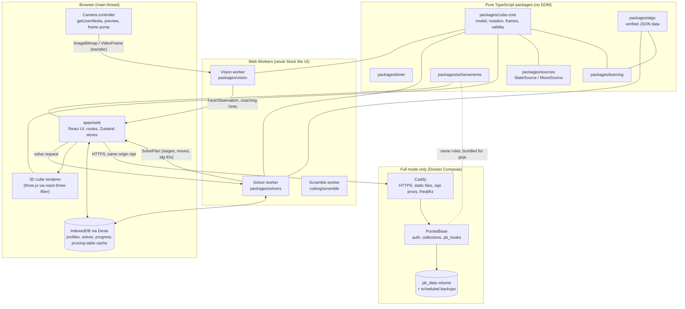
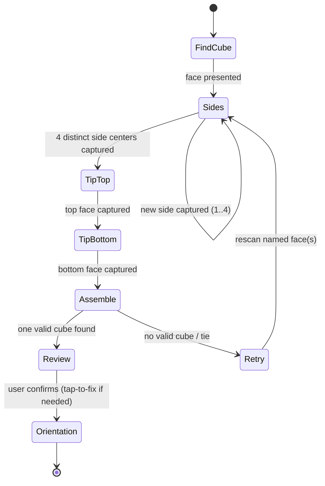

# SolvePath: Build Plan

Status: **approved 2026-11-16. M0 and M1 done (see `docs/milestones/`).** Revision 5 records changes found during M0 and M1.
Date: 2026-11-16
Source spec: `SOLVEPATH_SPEC.md`

This plan covers Section 11 of the spec: stack, licenses, architecture, data model, vision design, solver design, drill generation, Coach rules, risks, and milestones. Decisions and the few remaining questions are at the end (Section 13).

**Guiding principle (from the owner):** prefer mature, well-documented software over writing our own, so we don't reinvent wheels. Custom code only where no good open-source option exists (the cube vision pipeline, the human-method teaching solvers).

---

## 1. Corrections and updates to the spec

Working Rule 5 asks me to flag anything wrong or outdated. These are the ones I found while verifying.

| #   | Spec says                                                                                                | What I found                                                                                                                                                                                       | Proposed fix                                                                                                                                                                                                                                             |
| --- | -------------------------------------------------------------------------------------------------------- | -------------------------------------------------------------------------------------------------------------------------------------------------------------------------------------------------- | -------------------------------------------------------------------------------------------------------------------------------------------------------------------------------------------------------------------------------------------------------- |
| C1  | TypeScript (strict), implied latest                                                                      | TypeScript **7.0.2** (the new native compiler) is now `latest`. `typescript-eslint` 8.73.0 only supports TypeScript `<6.1.0`.                                                                      | **Decided:** ESLint 9 + typescript-eslint + Prettier with **TS 6.0.3** (the most mature, most documented setup). Revisit TS 7 when typescript-eslint supports it.                                                                                        |
| C2  | "Framer Motion (or Motion One)"                                                                          | Framer Motion was renamed. The package is now `motion` (14.14.0). `framer-motion` still publishes the same code.                                                                                   | Use `motion`.                                                                                                                                                                                                                                            |
| C3  | `eslint-plugin-jsx-a11y` (implied by a11y goals)                                                         | 6.10.2 does not declare support for ESLint 10.                                                                                                                                                     | **Updated in M0:** ESLint 9 is now deprecated on npm, so we use **ESLint 10.15.0**, with an npm `overrides` entry letting jsx-a11y 6.10.2 install. Its rules were tested working on ESLint 10. Remove the override when the plugin lists ESLint 10.      |
| C4  | Playwright fake camera "fed by fixture videos"                                                           | Chromium's `--use-file-for-fake-video-capture` only reads **Y4M** or **MJPEG** files, not MP4/WebM. Y4M is uncompressed and large.                                                                 | Store fixtures as compressed WebM/MP4 in the repo; a script converts them to Y4M (ffmpeg) into a git-ignored cache before e2e runs.                                                                                                                      |
| C5  | PocketBase in Docker Compose                                                                             | PocketBase has **no official Docker image**.                                                                                                                                                       | Build our own small image: `alpine:3.24.4` pinned by digest, download `pocketbase_0.40.6_linux_<arch>.zip`, verify against a SHA-256 pinned in the Dockerfile.                                                                                           |
| C6  | "Parent account (email + password, passkeys, or OAuth through PocketBase)"                               | I found no native passkey/WebAuthn support in PocketBase 0.40.x (it has password, email OTP, MFA, OAuth2).                                                                                         | **Decided:** parents sign in with **username + password**. Email is kept on the parent account only for verification and password reset. No OAuth, no passkeys in v1.                                                                                    |
| C7  | "ao5 ... ao1000 using WCA trimming rules"                                                                | WCA regulations only define Ao5 (and Mo3). Larger averages follow the csTimer convention: drop 5% from each end, rounded up (ao12 drops 1+1, ao50 drops 3+3, ao100 drops 5+5, ao1000 drops 50+50). | Implement the csTimer convention and say so in the Guide. I will confirm the exact rounding against csTimer's source in the timer milestone.                                                                                                             |
| C8  | "Use the 6 centers as cluster seeds"                                                                     | With the taught grip, fingers cover the **top and bottom centers**, so only 4 centers are ever seen directly.                                                                                      | Seed 4 clusters from the visible side centers, and the last 2 from the data (see 5.6). Top/bottom center colors are inferred.                                                                                                                            |
| C9  | Local-only mode stores everything in the browser                                                         | Safari (macOS and iOS) can **delete all site storage after 7 days without a visit** for sites that are not installed to the Home Screen. Guest data on iPhones and iPads is at real risk.          | Call `navigator.storage.persist()`, gently suggest "Add to Home Screen" on Safari, and offer a one-tap backup file. Full mode sync is the real fix. Explained in the Guide.                                                                              |
| C10 | cubing.js license MPL-2.0 / GPL-3.0-or-later                                                             | **Confirmed** for `cubing@0.66.1`. Its 3x3 solver is a vendored copy of min2phase by Chen Shuang under **MIT**. The npm package does not ship the license files.                                   | We add both license texts to `THIRD_PARTY_NOTICES.md`. We do not modify cubing.js, so MPL file-level duties do not apply to our code.                                                                                                                    |
| C11 | "two hidden corners leave 3 possible cube states"                                                        | Checked the math: correct (parity fixes the swap, twist sum leaves 3 options).                                                                                                                     | No change.                                                                                                                                                                                                                                               |
| C13 | (M0 finding) cubing.js in a Vite 8 production build                                                      | Its search worker crashed: Vite bundled the worker file as a normal chunk that imported the main app.                                                                                              | Fixed with two build settings in `apps/web/vite.config.ts`; guarded by the Diagnostics e2e test.                                                                                                                                                         |
| C14 | (M0 finding) three.js                                                                                    | cubing.js depends on its own `three@0.170.x`.                                                                                                                                                      | **Resolved in M1:** a root npm `overrides` entry makes everything use `three@0.187.0`, so only one copy is installed and bundled (checked in the build's source maps). cubing.js's 3D player (`cubing/twisty`) was built against 0.170; we don't use it. |
| C12 | Section 2: "Low-end hardware is the performance target, specifically school Chromebooks and older iPads" | **Owner decision (2026-11-16):** this is replaced. The floor is an **iPhone 14 Pro**. Older iPads do not constrain anything.                                                                       | New targets in 2.4.                                                                                                                                                                                                                                      |

---

## 2. Stack (verified 2026-11-16)

All versions are exact pins. "Checked" means I queried the npm registry or GitHub for current version, license, and recent activity. Browser support is covered in 2.4.

### 2.1 Runtime dependencies (shipped to users)

| Layer           | Package                               | Pinned version                    | License                             | Notes                                                                                                                                                                                                                                                                                                                                                               |
| --------------- | ------------------------------------- | --------------------------------- | ----------------------------------- | ------------------------------------------------------------------------------------------------------------------------------------------------------------------------------------------------------------------------------------------------------------------------------------------------------------------------------------------------------------------- |
| UI              | `react`, `react-dom`                  | 19.3.1                            | MIT                                 |                                                                                                                                                                                                                                                                                                                                                                     |
| Build           | `vite`                                | 8.3.8                             | MIT                                 | Rolldown-based. Default build target "baseline widely available" matches our browser floor.                                                                                                                                                                                                                                                                         |
| Build           | `@vitejs/plugin-react`                | 6.3.0                             | MIT                                 | Needs Vite 8.                                                                                                                                                                                                                                                                                                                                                       |
| Styling         | `tailwindcss`, `@tailwindcss/vite`    | 4.3.5                             | MIT                                 | v4 needs Safari 16.4+, Chrome 111+, Firefox 128+. Our floor (2.4) is above that.                                                                                                                                                                                                                                                                                    |
| Motion          | `motion`                              | 14.14.0                           | MIT                                 | Respect `prefers-reduced-motion` via `MotionConfig reducedMotion="user"`.                                                                                                                                                                                                                                                                                           |
| 3D              | `three` (+ `@types/three`)            | 0.187.0                           | MIT                                 |                                                                                                                                                                                                                                                                                                                                                                     |
| 3D              | `@react-three/fiber`                  | 9.8.2                             | MIT                                 | Peer range `react >=19 <19.4`: OK with 19.3.1. Pin and watch. It pulls in all of three.js (no tree-shaking): about 250 kB gzipped, loaded only on cube pages.                                                                                                                                                                                                       |
| 3D              | `@react-three/drei`                   | 10.7.9                            | MIT                                 | **Not used in M1:** the cube needed no helpers from it. Add it only when a feature needs it.                                                                                                                                                                                                                                                                        |
| Cube logic      | `cubing`                              | 0.66.1                            | MPL-2.0 OR GPL-3.0-or-later         | `cubing/alg` (parsing), `cubing/kpuzzle` (cross-check model), `cubing/scramble` (random-state scrambles). Actively maintained (pushed 2026-11-12).                                                                                                                                                                                                                  |
| Shortest solver | min2phase.js, vendored                | commit `0ba83a6177d8` (npm 0.0.4) | MIT (dual MIT/GPL-3.0; we take MIT) | By Chen Shuang (author of csTimer). We need its `solution(maxDepth, probeMax, probeMin)` and `next()` API for "best found within a time budget", which cubing.js does not expose. Vendored into `packages/solvers/vendor/` with its license, wrapped in TypeScript, covered by our tests. Last upstream commit 2024-06: stable, not abandoned, algorithm is mature. |
| State           | `zustand`                             | 5.1.0                             | MIT                                 |                                                                                                                                                                                                                                                                                                                                                                     |
| Storage         | `dexie`                               | 4.4.7                             | Apache-2.0                          | Open-source core only. We do not use Dexie Cloud (paid).                                                                                                                                                                                                                                                                                                            |
| Routing         | `react-router`                        | 8.5.1                             | MIT                                 | Data-router mode, hash or path routing (path routing needs a 404 fallback on static hosts; documented).                                                                                                                                                                                                                                                             |
| Search          | `minisearch`                          | 7.2.0                             | MIT                                 | Index built at build time, loaded offline. Last release 2025-09; small and stable.                                                                                                                                                                                                                                                                                  |
| i18n            | `i18next`                             | 27.1.3                            | MIT                                 | All UI strings in message catalogs from day one, English only for v1.                                                                                                                                                                                                                                                                                               |
| i18n            | `react-i18next`                       | 18.0.2                            | MIT                                 | Peer range covers TS 6.                                                                                                                                                                                                                                                                                                                                             |
| Workers         | `comlink`                             | 4.4.2                             | Apache-2.0                          | Typed RPC to Web Workers. Last release 2024-11; tiny, stable, GoogleChromeLabs. If it ever becomes a problem it is ~100 lines to replace.                                                                                                                                                                                                                           |
| Charts          | `uplot`                               | 1.6.32                            | MIT                                 | ~50 KB, very fast. Keeps the stats screen smooth on phones. Preferred over Recharts (heavier SVG).                                                                                                                                                                                                                                                                  |
| PWA             | `vite-plugin-pwa`                     | 2.0.0                             | MIT                                 | Supports Vite 8.                                                                                                                                                                                                                                                                                                                                                    |
| PWA             | `workbox-window`, `workbox-build`     | 7.4.1                             | MIT                                 |                                                                                                                                                                                                                                                                                                                                                                     |
| Backend SDK     | `pocketbase` (JS SDK)                 | 0.29.0                            | MIT                                 | Lazy-loaded only in full mode. Compatibility with server 0.40.6 to be confirmed in the accounts milestone.                                                                                                                                                                                                                                                          |
| Fonts           | `@fontsource-variable/lexend`         | 5.3.0                             | OFL-1.1                             | Lexend was designed for reading ease; good for kids. Self-hosted.                                                                                                                                                                                                                                                                                                   |
| Fonts           | `@fontsource-variable/jetbrains-mono` | 5.3.0                             | OFL-1.1                             | Timer digits and notation.                                                                                                                                                                                                                                                                                                                                          |
| Sound           | none                                  |                                   |                                     | Web Audio API synthesized ticks and chimes. No audio files, no licensing questions, tiny.                                                                                                                                                                                                                                                                           |

Markdown for the Guide is compiled at **build time** (not in the browser) with `unified` 11.0.5, `remark-parse` 11.0.0, `remark-gfm` 4.0.1, `remark-rehype` 11.1.2, `rehype-slug` 6.0.0, `rehype-stringify` 10.0.1 (all MIT). The browser receives pre-rendered HTML plus a MiniSearch index.

Vision: **custom TypeScript only**. No OpenCV.js unless the vision spike (M2) proves we need it. Hungarian algorithm and grid fitting are small enough to write and test ourselves.

### 2.2 Dev and test tooling

| Tool                               | Version                 | License      | Notes                                                                           |
| ---------------------------------- | ----------------------- | ------------ | ------------------------------------------------------------------------------- |
| Node.js                            | 24.22.3 (LTS "Krypton") | MIT          | `.nvmrc` + `engines`. Local machine has 24.18.0: fine for now, CI uses the pin. |
| npm workspaces                     | npm 11.x                | Artistic-2.0 | No pnpm/Turborepo: one fewer tool to install and explain.                       |
| `typescript`                       | 6.0.3                   | Apache-2.0   | See C1. Strict mode.                                                            |
| `eslint` / `@eslint/js`            | 10.15.0 / 10.0.1        | MIT          | Flat config. (ESLint 9 is deprecated; see C3.)                                  |
| `typescript-eslint`                | 8.73.0                  | MIT          | Type-aware rules (floating promises etc.).                                      |
| `eslint-plugin-react-hooks`        | 7.1.1                   | MIT          |                                                                                 |
| `eslint-plugin-jsx-a11y`           | 6.10.2                  | MIT          | Accessibility lint. Installed with an npm `overrides` entry for ESLint 10 (C3). |
| `prettier`                         | 3.10.1                  | MIT          | Formatting.                                                                     |
| `eslint-config-prettier`           | 10.1.8                  | MIT          | Keeps ESLint and Prettier from fighting.                                        |
| `vitest`                           | 5.1.0                   | MIT          |                                                                                 |
| `fast-check`                       | 4.10.2                  | MIT          | Property tests.                                                                 |
| `@playwright/test`                 | 1.65.1                  | Apache-2.0   | e2e with fake camera (Chromium).                                                |
| `@axe-core/playwright`             | 4.14.0                  | MPL-2.0      | Automated a11y checks in e2e. Dev only.                                         |
| `jsdom`                            | 31.0.1                  | MIT          | Component tests.                                                                |
| `@testing-library/react`           | 16.3.3                  | MIT          |                                                                                 |
| `fake-indexeddb`                   | 6.2.8                   | Apache-2.0   | Dexie tests in Node.                                                            |
| `@types/react`, `@types/react-dom` | 19.3.0                  | MIT          |                                                                                 |
| `@types/node`                      | 24.19.2                 | MIT          | Matches Node 24.                                                                |
| `@vitejs/plugin-basic-ssl`         | 2.3.0                   | MIT          | Fallback dev HTTPS when mkcert is not installed.                                |
| mkcert (system tool)               | from OS package manager | BSD-3-Clause | Trusted local certs for `make dev`. Not an npm dependency.                      |
| ffmpeg (system tool)               | from OS package manager | LGPL/GPL     | Dev-only: converting fixture videos. Never shipped. Already installed here.     |

### 2.3 Server and deploy (full mode)

| Component                | Pin                                                                                           | License                  | Notes                                                                                                                           |
| ------------------------ | --------------------------------------------------------------------------------------------- | ------------------------ | ------------------------------------------------------------------------------------------------------------------------------- |
| PocketBase               | v0.40.6 (2026-10-23)                                                                          | MIT                      | Pre-1.0. Our own image (C5). Built-in auth, rate limiter, scheduled backups with retention, admin UI at `/_/`, JS hooks (goja). |
| Caddy                    | `caddy:2.11.9-alpine@sha256:003a97808e781aa9f7e75cc2f43d34d461099031faf5e20faefb9f61126836f0` | Apache-2.0               | Multi-arch index digest. Automatic HTTPS.                                                                                       |
| Alpine (PocketBase base) | `alpine:3.24.4@sha256:f59abe656b692d901e184be3445e084786602108599d2a51d229c0f5a48c71bf`       | MIT (+ package licenses) |                                                                                                                                 |
| Node (web build stage)   | `node:24.22.3-alpine@sha256:116b800c3754b440ee0aa3ed2f20f5bf3d99a554bfd9adeea09ea8017f6e85f5` | MIT                      | Only used to build the static site inside Docker.                                                                               |

Digests were read with `skopeo inspect` today and will be re-checked in M0.

### 2.4 Browser floor and performance targets

**Owner decision:** the floor device is an **iPhone 14 Pro**. If it runs well there, it ships. Older iPads do not constrain any decision.

| Browser                            | Minimum   | Why                                                                                                                                                  |
| ---------------------------------- | --------- | ---------------------------------------------------------------------------------------------------------------------------------------------------- |
| Safari iOS / iPadOS / macOS        | 18.0      | Comfortably covers the iPhone 14 Pro (which runs current iOS) and gives us modern camera, worker, and WebGL behavior without old-Safari workarounds. |
| Chrome / Edge / ChromeOS / Android | 120       | Anything from the last 2 years.                                                                                                                      |
| Firefox                            | 128 (ESR) | Tailwind v4 needs 128.                                                                                                                               |

| Target                            | iPhone 14 Pro ("buttery smooth")                                          | Laptop or desktop from the last 2 years ("smooth as silk") |
| --------------------------------- | ------------------------------------------------------------------------- | ---------------------------------------------------------- |
| 3D cube and UI animation          | Steady 60 fps, no dropped frames during turns; 120 Hz where Safari allows | Display refresh rate (60-144 Hz)                           |
| Frame budget on the main thread   | No task over 16 ms during animations                                      | No task over 8 ms                                          |
| Camera preview                    | 30 fps                                                                    | 30 fps                                                     |
| Vision worker                     | 15 Hz, ≤ 25 ms per frame                                                  | 15 Hz, ≤ 10 ms per frame                                   |
| "Shortest" solve                  | ≤ 1 s (best found)                                                        | ≤ 0.5 s                                                    |
| Human-method solve plan           | ≤ 300 ms after tables are cached                                          | ≤ 100 ms                                                   |
| First-run pruning tables          | ≤ 3 s with progress bar, then cached                                      | ≤ 1 s                                                      |
| Cold start to usable (cached PWA) | ≤ 1.5 s                                                                   | ≤ 1 s                                                      |

These are checked on the benchmark page (spec 8) and on real devices: the iPhone 14 Pro, a current Google Pixel, an iPad Pro, and a recent laptop. Chromebooks are expected to be fine (2025 models) but aren't on the test list.

Runtime feature checks with fallbacks: `requestVideoFrameCallback`, `VideoFrame` transfer, `navigator.storage.persist`, `MediaStreamTrackProcessor` (Chrome fast path).

### 2.5 Repo license

**Decided: MPL-2.0 for code, CC BY 4.0 for Guide text and course content.**

- Compatible with cubing.js (MPL-2.0 option), min2phase (MIT), and everything else above (MIT, Apache-2.0, ISC, OFL for fonts).
- Anyone can self-host or fork. Changes to _our_ files must stay open, which keeps improvements flowing back, but nobody is forced to open-source their own surrounding code.
- AGPL-3.0 would force hosted forks to publish source, but it scares off schools and districts that might want to self-host. MIT would be the most permissive option.

---

## 3. Architecture

### 3.1 Module map



### 3.2 Repo layout

As in spec Section 4, plus:

```
config/brand.ts            # App name + domain in one place (Rule 11). Imported everywhere.
packages/test-fixtures/    # Fixture metadata, video conversion cache (git-ignored), helpers
tools/                     # Dev-only scripts: fixture recorder, labeler, guide anchor check, version report
THIRD_PARTY_NOTICES.md
```

### 3.3 Key boundaries

- **cube-core is the source of truth.** It exports `CubeState`, `Move`, `Alg`, `Face`, `Orientation`, `ColorScheme`, `CubeProfile`, `FaceletString`, plus the single `userFrameFromCamera()` transform.
- **Two cube models, cross-checked.** cube-core has its own fast typed-array cubie model (solvers need millions of moves per second). A property test checks that it agrees with `cubing/kpuzzle` on random sequences. Two independent implementations agreeing is our strongest guard against a wrong move definition.
- **Centers are modeled explicitly** (24 orientations). Slice moves (M E S) and rotations change orientation. Solvers work on orientation-normalized states and output moves in the user's frame. The renderer follows orientation changes, so "white on top" stays true on screen when it is true in the hand.
- **Workers talk through Comlink** with plain data only (typed arrays, JSON). No class instances across the boundary.
- **No package imports from `apps/web`.** Packages never touch the DOM, except `vision` which uses `OffscreenCanvas` inside its worker entry only.

### 3.4 Conventions (documented in `packages/cube-core/README.md`)

- **Composition is left to right:** `A · B` means "do A, then do B". A state is the group element you get by applying a sequence to solved.
- **Solving** state `S` means finding `X` with `S · X = I`.
- **Pattern goals:** to go from `S` to target `T`, solve the relative state `Q = T⁻¹ · S`. If `Q · X = I`, then `S · X = T`. Physically, `Q` is "apply the inverse of T's generator, then S". This is the spec's formula; the property test in 6.8 proves it.
- **User frame:** U is up, F is the face pointing at the user's eyes. The camera faces the user, so the face pointing at the camera is the user's **B**. Raw camera image left/right is mapped to the user's right/left by the per-camera calibration (5.4), never by assumption.

---

## 4. Data model

### 4.1 Principles

- Every record has a client-generated UUID v4 `id` (via `crypto.randomUUID()`, no library), `created_at`, `updated_at` (client clock, ms).
- **Solves are insert-once.** Their identity and core facts (time, scramble, method) never change. A few fields are editable (penalty, session, deleted). Edits sync as last-write-wins using `updated_at`. Deletion is a tombstone (`deleted_at`) so it syncs, followed by a real purge after sync (and immediately in "Delete all data").
- **Settings are last-write-wins** per player.
- Local-only mode uses the same shapes in Dexie. Moving guest data into an account uploads the same records unchanged.

### 4.2 Collections

| Collection                           | Fields                                                                                                                                                                                                                                                                                                                                                                                                                                                                            | Where           | Notes                                                                                                                                                  |
| ------------------------------------ | --------------------------------------------------------------------------------------------------------------------------------------------------------------------------------------------------------------------------------------------------------------------------------------------------------------------------------------------------------------------------------------------------------------------------------------------------------------------------------- | --------------- | ------------------------------------------------------------------------------------------------------------------------------------------------------ |
| `users` (parents)                    | PocketBase auth fields: `username` (sign-in identity), password hash, `email` (verification and reset only), verified                                                                                                                                                                                                                                                                                                                                                             | server          | The only place an email exists. Sign-in is username + password.                                                                                        |
| `players`                            | `parent` → users, `name_word1`, `name_number`, `name_word2`, `avatar_id`, `theme_id`, `settings` (JSON), `leaderboard_visible` (bool, **default true**, see 13 and R9), `grown_up_mode` (bool)                                                                                                                                                                                                                                                                                    | both            | No email, real name, birthday, photo, or free text.                                                                                                    |
| `cube_profiles`                      | `player`, `name_preset_id` + optional `name_number` (picked, never typed), `colors[6]` (OKLab triplets), `color_names[6]` (from a curated list), `face_map` (face → color index), `marked_color` (nullable index), `mark_style` (dot color)                                                                                                                                                                                                                                       | both            | Profile and color names are **picked from lists**, not typed, so there is no free text (spec 5.9). "My blue-and-pink cube" is built from picked words. |
| `camera_calibrations`                | `device_id`, `label_hash`, `user_right_is_image` (`left`/`right`), `calibrated_at`                                                                                                                                                                                                                                                                                                                                                                                                | local only      | Never synced.                                                                                                                                          |
| `sessions`                           | `player`, `name_preset_id`/number, `created_at`, `order`                                                                                                                                                                                                                                                                                                                                                                                                                          | both            | Session names also from a picker plus number ("Practice 3").                                                                                           |
| `solves`                             | `player`, `session`, `id` (client UUID), `event` (`333` for now; cheap hook for other puzzles), `player_solve_number` (this player's running solve count when the solve was logged), `time_ms`, `penalty` (`ok`/`plus2`/`dnf`), `scramble`, `scramble_id` (nullable), `scramble_kind` (`random`/`easy`/`practice`/`weekly`), `method`, `guided`, `phase_splits` (int array, ms), `inspection_ms`, `source` (`timer`/`guided`/`virtual`), `created_at`, `updated_at`, `deleted_at` | both            |                                                                                                                                                        |
| `learning_progress`                  | `player`, `lesson_id`, `status` (`not_started`/`started`/`done`), `stats` (JSON), `updated_at`                                                                                                                                                                                                                                                                                                                                                                                    | both            |                                                                                                                                                        |
| `drill_results`                      | `player`, `drill_id`, `time_ms`, `success`, `moves_used`, `created_at`                                                                                                                                                                                                                                                                                                                                                                                                            | both            |                                                                                                                                                        |
| `trainer_results`                    | `player`, `case_id`, `mode` (`recognize`/`execute`), `time_ms`, `success`, `created_at`                                                                                                                                                                                                                                                                                                                                                                                           | both            |                                                                                                                                                        |
| `srs_state`                          | `player`, `case_id`, `box` (Leitner 1-5), `due_at`, `updated_at`                                                                                                                                                                                                                                                                                                                                                                                                                  | both            | Derived but stored for speed.                                                                                                                          |
| `quiz_results`                       | `player`, `lesson_id`, `question_seed`, `correct`, `created_at`                                                                                                                                                                                                                                                                                                                                                                                                                   | both            |                                                                                                                                                        |
| `alg_usage`                          | `player`, `alg_id`, `count`, `preferred_variant`                                                                                                                                                                                                                                                                                                                                                                                                                                  | both            | Feeds "My algorithms" and "You'll see this one again".                                                                                                 |
| `achievement_defs`                   | `id`, `rule` (JSON), `version`                                                                                                                                                                                                                                                                                                                                                                                                                                                    | server (seeded) | Seeded from `packages/achievements`. Client ships the same JSON.                                                                                       |
| `achievements_earned`                | `player`, `achievement`, `earned_at`, `solve` (nullable)                                                                                                                                                                                                                                                                                                                                                                                                                          | both            | Server copy is authoritative.                                                                                                                          |
| `scrambles_issued`                   | `id`, `scramble`, `week`, `issued_at`                                                                                                                                                                                                                                                                                                                                                                                                                                             | server          | Pre-generated offline (see 8.3).                                                                                                                       |
| `weekly_challenges`                  | `week` (ISO week, e.g. `2026-W47`), `scramble_ids[5]`, `starts_at`, `ends_at`                                                                                                                                                                                                                                                                                                                                                                                                     | server          |                                                                                                                                                        |
| `friend_codes`                       | `parent`, `code`, `expires_at`, `used_by`                                                                                                                                                                                                                                                                                                                                                                                                                                         | server          | Optional Friends scope: parent-approved invite codes.                                                                                                  |
| `friendships`                        | `player_a`, `player_b`, `approved_by_parent_a`, `approved_by_parent_b`                                                                                                                                                                                                                                                                                                                                                                                                            | server          |                                                                                                                                                        |
| `reports`                            | `reporter` (parent), `solve`, `reason` (enum), `created_at`, `status`                                                                                                                                                                                                                                                                                                                                                                                                             | server          |                                                                                                                                                        |
| `lb_public_*` (view collections)     | `time_ms`, `penalty`, `method`, `guided`, `week`, `solved_at` (date), `player_solve_number` ("solve #143"), `player_total_solves`, `days_since_first_solve`. **No name, no avatar** (shown as "A SolvePath player")                                                                                                                                                                                                                                                               | server          | What logged-out visitors can see.                                                                                                                      |
| `lb_*` (view collections, signed-in) | Everything in `lb_public_*` plus `display_name` (the generated name, like "Swift42Otter") and `avatar_id`                                                                                                                                                                                                                                                                                                                                                                         | server          | Signed-in families only. **Never** includes the parent's username or email.                                                                            |

### 4.3 API rules (PocketBase)

- `players`, `cube_profiles`, `sessions`, `solves`, progress, results: list/view/create/update/delete only when `@request.auth.id = player.parent`.
- Players are never auth records. A parent's signed-in device can switch between that parent's players (a device-local parent PIN guards the parent dashboard and settings).
- `lb_public_*` views: readable by anyone, with names hidden. `lb_*` views: readable only when signed in, showing generated player names. Both only include players with `leaderboard_visible = true` and solves not hidden by admin. A parent's sign-in username and email are never shown to anyone else, anywhere.
- `reports`: create by any signed-in parent, read by admin only.
- Built-in rate limiter enabled on `/api/collections/solves/records` (create) and auth endpoints.
- A `pb_hooks` validation hook does **sanity checks only** (time is positive and under 24 hours, scramble present). **There is no speed floor:** a first solve at any speed gets a player onto the board. The floor setting from the spec still exists but defaults to 0 (off).
- Weekly Challenge solves need a valid `scramble_id` for the current week.
- `player_solve_number` is recomputed on the server at insert time (count of that player's solves with an earlier `created_at`) so offline syncs land in the right order.

---

## 5. Vision design (the riskiest part)

### 5.1 Goals and budget

- Read all 54 stickers of a physical 3x3 from a ~10 second grip-and-spin, for standard and custom color sets, smoothly on an iPhone 14 Pro and recent laptops.
- Preview at 30 fps on the main thread (just a `<video>` element). Vision at **15 Hz** in a worker, with a per-frame budget of **≤ 25 ms** on the iPhone 14 Pro (2.4).
- Never store or upload frames. Frames live in worker memory for one processing step and are closed (`ImageBitmap.close()` / `VideoFrame.close()`).

### 5.2 Frame pipeline

1. **Capture (main thread):** `getUserMedia({ video: { width: { ideal: 1280 }, height: { ideal: 720 }, facingMode: "user" } })`. A frame pump driven by `requestVideoFrameCallback` (fallback: `setTimeout`) runs at 12 Hz.
2. **Transfer:** each tick creates **two** bitmaps with `createImageBitmap(video, ...)`: a 320 px wide downscale for detection, and a full-resolution crop of the last known cube region (for sticker sampling and mark detection). Both are transferred (zero-copy) to the vision worker. Chrome fast path: `MediaStreamTrackProcessor` inside the worker, if available.
3. **Back-pressure:** at most one frame in flight. If the worker is busy, the pump skips. The UI never waits.
4. **Worker:** draws into an `OffscreenCanvas`, reads pixels, converts to OKLab (lookup table for sRGB→linear), runs the steps below, posts a small `FrameResult`, closes the bitmaps.

### 5.3 Face detection and grid fitting

A guide square is drawn over the preview ("Keep the cube in the box"). This narrows the search a lot, keeps the per-frame cost low on phones, and makes detection more reliable.

**Grid fit:** find the face as a square with parameters (center x, y, size, small rotation, slight perspective skew) that maximizes a **grid score**:

- _Cell uniformity:_ low color variance inside each of the 9 cells (inner 60% of each cell).
- _Boundary evidence:_ gradient energy along the 4 inner grid lines and the outer border. Works for **stickered** cubes (dark gaps) and **stickerless** cubes (color edges and thin plastic seams).
- _Outer silhouette:_ contrast between the face border and the background ring just outside it. This is what still works when a face is one solid color (a solved face has no inner color edges).

Search is coarse-to-fine: a grid of candidate centers and sizes on the 320 px image, then local refinement (a few iterations of pattern search), seeded from the previous frame's fit. Typically 2-5 ms.

**"A face is presented" signal:** the best fit is near-square, its score is above a threshold, and per-cell colors are confident. During a quarter turn the camera sees two faces at an angle and the score drops sharply. That gives a clean high / low / high rhythm as the user spins.

**Auto-capture:** when a face has been presented and stable (low motion, same 9 color labels) for 4 processed frames (~330 ms), we capture it. We keep the per-sticker **median over those frames** for robustness, then play the capture animation and fill that face on the mini cube.

### 5.4 Left/right calibration (once per camera)

- Prompt: "Hold the cube up, then move it to your right" with a 3-second countdown.
- Track the cube's centroid across the countdown (frame differencing plus a chroma mask, largest blob, inside the full frame). Fit a line to x over time.
- If the cube moved toward **image-left** in raw frames, the feed is normal (a camera facing you sees your right on its left). If it moved toward **image-right**, the feed is flipped (OBS Virtual Camera, some webcam tools, or a rear camera). Require a clear move (> 15% of frame width) and a consistent direction; otherwise "Let's try that again, a bit bigger".
- Store `user_right_is_image` per `deviceId`. `deviceId` is stable per site until site data is cleared, so calibration may re-run after clearing data. That is fine.
- **Mirror camera preview** is a separate display setting (CSS `scaleX(-1)` on the `<video>`). Processing never looks at it.

### 5.5 Grip-and-spin scan state machine



**Side faces:** the grip keeps the vertical axis fixed, so side faces are always upright. Side centers are visible (the fingers are on top and bottom). **Each side face is identified by its center color**, so the user does not need perfect order, and a face seen twice is recognized and merged, not added again.

**Spin direction:** between captures, the worker estimates horizontal motion inside the box (phase correlation on a downscaled luminance strip, accumulated over the transition). Its sign, combined with the camera calibration, says whether the next face came from the user's left or right. That gives the cyclic order of the 4 side faces.

**Top and bottom:** "Tip the top toward the camera". Vertical motion confirms a tip, not a spin. The top's grid rotation follows from which side face was toward the camera just before the tip. The top center is under a finger, so it is marked _occluded_; same for the bottom.

**Assembly with constraint checking (the key robustness trick):** motion gives us a best guess, then piece validity confirms it. We enumerate hypotheses: side order (2 directions) x top rotation (4) x bottom rotation (4) = 32. For each one we build a facelet cube, fill occluded stickers by inference, and score it by (a) sum of per-sticker color log-likelihoods and (b) cube-core validity (every corner and edge is a real piece, twist, flip, parity). We keep the best **valid** hypothesis. If two valid hypotheses are close, or none are valid, we ask the user to rescan just the doubtful face.

**Mirror ambiguity (why calibration matters):** for a **known** color scheme (the standard one, or a saved profile), a mirrored assembly produces impossible corners, so validity catches it. For a **brand-new custom-color cube** the scheme is learned from the same scan, and a mirror-image scan is self-consistent. Only the measured spin direction (plus calibration) can tell them apart. If the direction signal is weak, the review screen asks one question: "Is this the color on your right?" with two big buttons. Covered by a dedicated test (6.8).

### 5.6 Color classification

1. **Sampling:** for each sticker, take the inner ~50% patch from the full-resolution crop. Drop glare pixels (high lightness, near-zero chroma, or clipped channels). Take the per-channel **median in OKLab**. If more than 40% of a patch is glare, mark the sticker low-confidence and coach "Tilt the cube a little to get rid of the shine".
2. **Seeds:** 4 visible side centers seed 4 clusters. The other 2 seeds (the covered top and bottom colors) come from k-means++ on the stickers that are far from the first 4 seeds.
3. **Balanced assignment:** exactly 9 stickers per color (the 8 visible top stickers + the inferred center, etc.). We solve it as an assignment problem with the **Hungarian algorithm** on a 54 x 54 cost matrix (each cluster replicated 9 times, centers fixed). Cost is a weighted OKLab distance that counts lightness less than hue and chroma (shading changes lightness most). Then recompute centroids (trimmed mean) and repeat until stable (constrained k-means, usually 2-4 rounds).
4. **Confidence:** for each sticker, the extra cost of moving it to its second-best color, normalized. This drives tap-to-fix.
5. **Validity repair:** if the cube is invalid, search for the smallest set of changes (up to 3) among the least-confident stickers that makes it valid while keeping 9-per-color. Pre-apply the fix, highlight those stickers, say "We might have read these 2 stickers wrong. Tap to check them."
6. **White balance per session:** with a saved profile, fit a diagonal (von Kries) correction that maps this session's 6 centroids onto the profile's 6 colors, then classify against the profile. Without a profile we don't need absolute colors: clustering is relative.
7. **Cube profiles:** after a confirmed scan, save the 6 centroid colors and the face map. Later scans start from the profile seeds, which makes them faster and more accurate.

### 5.7 Lighting and distance coach

Cheap per-frame stats inside and around the guide box drive one short prompt at a time (with hysteresis so it doesn't flicker):

| Prompt                                     | Signal                                                              |
| ------------------------------------------ | ------------------------------------------------------------------- |
| "More light please"                        | median lightness of the box below threshold, or high temporal noise |
| "Light is behind you. Try facing a window" | background ring much brighter than the cube                         |
| "Warm light. Try a different lamp"         | strong yellow/orange cast across the neutral parts of the frame     |
| "Slower"                                   | motion blur (low Laplacian variance) or big jumps between frames    |
| "A bit closer" / "A bit farther"           | fitted face size vs guide size                                      |
| "Got it!"                                  | face captured                                                       |

### 5.8 Marking mode (two colors stay confused)

- Trigger: the same two colors are swapped or low-confidence across 2 scans (classic example: red and orange under warm light).
- Instruction: mark **all 9 stickers of one of the two colors** (including its center) with a small removable dot: an office label dot or a dot of painter's tape. Warn that ink may stain. The app **suggests a dot color** with high contrast against both confused colors (usually black or white).
- Detection: for each sticker currently assigned to either confused color, cluster that sticker's full-resolution pixels into 2 groups. "Marked" means a compact second group covering ~8-40% of the cell, with a large color difference from the main group. The main group is the sticker's real color.
- Use: among the 18 stickers of the confused pair, the marked ones get color A and unmarked get color B, with the constraint of exactly 9 marked (Hungarian again, with mark confidence as cost). Saved as `marked_color` on the profile, so future scans use it automatically.
- Mark detection uses the full-resolution crop, where each sticker is ~40-80 px wide at 30-50 cm.

### 5.9 Escalation order (spec 5.2)

Lighting coach → tap-to-fix (always available on review) → marking mode → manual 2D net editor. Manual entry is always reachable with one tap, and the virtual cube path is always available.

### 5.10 Quick check

One-face scan of the face toward the camera (the user's **B** face). Compare its 9 stickers with the expected B face. Match: "Looks right!" No match: "Something's different. Let's do a full rescan."

### 5.11 Fixtures and accuracy metric

- **Ground truth from legal moves (Rule 7):** to record a fixture, start from a solved cube, apply a known scramble (shown by the tool), then record the grip-and-spin. The fixture's true state is "solved + scramble". No hand labeling of stickers.
- `tools/fixture-recorder/`: a **dev-only** page (excluded from the production build and from the PWA) that records a clip with `MediaRecorder` and downloads it with a metadata JSON: scramble, cube profile, lighting tag (daylight / warm bulb / dim / glare / studio), camera, flipped feed yes/no, marked yes/no. This is the only code in the project that records video, it never runs in the app, and it saves only to your own disk.
- `npm run fixtures:add <clip> <meta.json>` validates and copies into `packages/test-fixtures/vision/`.
- CI metrics: per-sticker accuracy, full-cube accuracy, and "needed tap-to-fix" rate per lighting tag. Thresholds start as "no regressions" and tighten as fixtures grow. Results are written to a markdown table on each run.
- Minimum fixture set for M2: standard stickered cube, standard stickerless cube, two non-standard color schemes, one marked cube, daylight/warm/dim/glare, a normal and a flipped feed.
- **Available real cubes:** a GAN 356 i Carry (stickerless, standard colors) and a Duncan speed cube. The owner will record as many clips as needed, and short WebM clips may go in the public repo (hands and cube only).
- **Color sets (owner decision):** "non-standard" here means colors that differ from the official brand shades. Both real cubes qualify: the GAN 356 i Carry's stickerless plastic and the Duncan cube's colors are each their own set. **If the GAN cube scans reliably, that is the bar for now.** Detection can be refined later. Synthetic fixtures (rendered from our own 3D cube with noise, blur and lighting) are still used for unit tests and for cases that are hard to stage, like a flipped camera feed. Recoloring real clips is parked as a later idea.

### 5.12 Fallbacks if the spike struggles

Decided at the end of M2 with data, not guesses:

1. Tighten the guide box and add a "hold still on each face" mode (slower but very reliable).
2. Lazy-load OpenCV.js (Apache-2.0, several MB, only on the scan screen) for contour-based detection.
3. One-face-at-a-time scan with on-screen prompts as a permanent alternative mode.

---

## 6. Solver design

All solvers run in the solver worker. Pruning tables are generated on first use with a progress bar, then cached in IndexedDB (keyed by table name + version). Budget: total cached tables under ~15 MB.

### 6.1 Output format

```ts
interface SolvePlan {
  method: MethodId; // shortest | beginner | cfop2 | cfop | roux | zz
  goal: GoalId; // solved | pattern:<id>
  holdInstruction: HoldInstruction; // "white on top, green facing you"
  stages: SolveStage[];
  totalMoves: number;
  labelHint: "shortest-found" | "method";
}
interface SolveStage {
  id: string; // e.g. "cfop.f2l.2"
  name: string; // "F2L pair 2"
  purpose: string; // one plain sentence
  moves: Move[]; // in the user's frame, rotations included
  algIds: string[]; // e.g. ["pll.t"]
  caseId?: string; // e.g. "oll.27"
}
```

### 6.2 Shortest

- Vendored min2phase. First call `solution(facelets, 21, probeMax, probeMin)`, then keep calling `next()` with a lower max depth until the time budget runs out (default 1 s on phones, 0.5 s on laptops, measured on the iPhone 14 Pro in M3). Return the best found.
- UI label: **"Shortest found"**. Never "optimal".
- Table init: min2phase builds its tables in ~100-300 ms; cached results not needed, but we measure.

### 6.3 Beginner (layer by layer)

A **rule-based teaching solver**, not a search, so every step matches what the lesson teaches and can be explained. Stages from the spec: white cross, white corners, middle edges, yellow cross, yellow edges, position yellow corners, orient yellow corners.

- White cross: per edge, small IDA* (≤ 7 moves) that places one edge without breaking placed ones, labeled with the lesson's patterns where possible.
- White corners: "bring the corner above its spot, then repeat R U R' U' until it is solved" (exactly the lesson's trigger).
- Middle edges: the two standard insert algorithms (left and right).
- Last layer: the standard beginner algorithms (F R U R' U' F' for the yellow cross; Sune-family for edges; the 3-corner cycle; R' D' R D repetitions for orientation).
- All algorithms come from the verified data in `packages/algs`.
- Hold orientation (**decided**): build the white cross **on top** where it is easy to see, then one "flip the cube over" step, then white on the bottom for the rest. This is how the owner solves today. The 2-Look CFOP course teaches building the cross on the bottom directly.

### 6.4 2-Look CFOP and Full CFOP

- **Cross:** optimal IDA* on the 4 cross edges with a full BFS pruning table (190,080 states). Max 8 moves. Default cross color white, with an optional "any color" setting that picks the shortest of 6.
- **F2L (shared by both):** human-style case lookup, which is teachable and emits alg IDs:
  1. For each unsolved slot, check where its corner and edge are.
  2. If a piece is stuck in another slot or in the wrong slot, extract it with a short pull-out (verified sequences).
  3. Rotate (y) so the slot is front-right, find the U-turn (0-3) that matches one of the 41 verified F2L cases, apply that case.
  4. Greedy over slot order: try all remaining slots, pick the shortest total. Optionally a 2-step lookahead if fast enough.
     Restricted search is a fallback for odd cases (IDA* on the pair with cross + solved pairs as constraints, depth ≤ 9).
- **Last layer:**
  - 2-Look: OLL in two looks (edge orientation: 3 cases; corner orientation OCLL: 7 cases) = 10 algs. PLL in two looks (corner permutation: 2 cases; edge permutation: 4 cases) = 6 algs.
  - Full: OLL 57 + PLL 21, with pre-AUF matching (try 4 U turns) and post-AUF.
- **Stage detection** reports cross, each F2L slot, OLL done, PLL done.

### 6.5 Roux (M8)

- **First block** (1x2x3 on the left): IDA* with two pruning tables (block corners; block edges) and max of the two as heuristic. Choose the best of the available block orientations for the hold color.
- **Second block:** IDA* restricted to `<R, r, U, M>`, preserving the first block, with its own pruning tables.
- **CMLL:** case lookup over the verified CMLL set with pre-AUF.
- **LSE:** the `<M, U>` state space is small enough for full BFS. Solved in the human order: 4a edge orientation, 4b UL/UR, 4c last 4 edges, each as an optimal sub-goal so it stays teachable.

### 6.6 ZZ (M8)

- **EOLine:** IDA* with combined pruning (edge orientation 2,048 states x line edges DF/DB).
- **ZZ F2L:** left 1x2x3 block with `<L, U, R>` then right block with `<R, U>`, each via IDA* with block pruning tables. Optionally pair-by-pair later.
- **Last layer:** OCLL (7) + PLL (21), shared data with CFOP.

### 6.7 Patterns

- Library from spec 5.5 (15 patterns). Each entry: `id`, name, difficulty, generator sequence from solved, source reference, and an **independent check** (see 7.3).
- To reach pattern `T` from scanned `S`: two-phase solve of `T⁻¹ · S` (3.4). Human methods: solve to solved, then append the generator as a labeled "Make the pattern" stage.
- Thumbnails rendered from the pattern state at build time (SVG nets) plus live 3D.

### 6.8 Solver tests

- **1,000 random-state scrambles per method** (seeded, reproducible): the plan solves the cube; each stage boundary passes stage detection; no stage undoes an earlier one; time budget holds (measured in Node; real-device numbers from the benchmark page).
- **Pattern goals:** for random `S` and every pattern `T`, `S · plan = T` exactly (property test).
- **Rescan logic:** simulated on-track, ahead by k, behind by k, single wrong-direction turn, wrong face, two-move mistake, and unrelated state.
- **Frames:** for all 24 orientations, scanning a rotated cube and normalizing gives the same state. Mirror test: a mirrored scan of a new custom scheme is flagged as ambiguous unless direction evidence exists.
- **Cross-check:** cube-core vs `cubing/kpuzzle` on 10,000 random sequences.

---

## 7. Algorithm data and verification (Rules 6 and 7)

### 7.1 Data format

`packages/algs/data/*.json`: one entry per case:

```json
{
  "id": "pll.t",
  "set": "pll",
  "name": "T-Perm",
  "case": { "kind": "pll", "signature": "<permutation signature>" },
  "algs": [
    {
      "moves": "R U R' U' R' F R2 U' R' U' R U R' F'",
      "source": "<reference URL>",
      "default": true
    }
  ],
  "tags": ["2-look-pll", "full-pll", "beginner-friendly"],
  "alsoUsedIn": ["lesson.cfop2.pll", "lesson.cfop.pll"]
}
```

I will source every algorithm from published references at the time I write the data (with the source URL in each entry). I will not type any from memory without a test proving it.

### 7.2 Layered verification (CI fails on any mismatch)

1. **Parses** with `cubing/alg`, and only uses allowed moves for its set (e.g. `<R, U>` claims must really be `<R, U>`).
2. **Preserves what it must:** OLL/PLL/OCLL keep F2L solved; CMLL keeps both Roux blocks; F2L algs keep the cross and other slots; beginner algs keep the layers they claim to keep.
3. **Does what its case says:** apply the **inverse** of the alg to solved to get the case state (a legal-move state, Rule 7), then compute its case signature (OLL: the 20 top-layer sticker orientations up to AUF; PLL: corner and edge permutation up to pre- and post-AUF; F2L: corner and edge position/orientation relative to the slot; CMLL: corner orientation + permutation up to AUF). It must equal the signature stored for that case ID.
4. **Coverage proofs that can't be faked:** enumerate every reachable last-layer orientation state and group them by AUF. The OLL set must map one-to-one onto the non-solved classes (we expect 57; the test computes the number rather than trusting it). Same for PLL (21), OCLL (7), 2-look subsets, F2L (41), and CMLL (count computed by the test).
5. **Alternatives agree:** all variants in one entry give the same case up to AUF.

Step 4 is what catches a mistyped alg that happens to preserve F2L: it would land in the wrong class or collide with another entry.

### 7.3 Patterns

Pattern correctness is about the picture, not a case class. Each pattern gets an **independent check** written separately from its generator:

- Where possible a **predicate** (Superflip: every edge flipped in place, everything else solved; Checkerboard: every face alternates its own color with the opposite color; Cube in a Cube: a specific 2x2x2 block pattern...).
- Otherwise an **expected net** transcribed from the reference picture, used only as a test oracle. The pattern's state in the app always comes from the generator (Rule 7); the net just checks it.

### 7.4 Practice positions

Defined as sequences only (`"setup": "..."`). Their tests check the declared intent: "OLL 27 practice" must have case signature `oll.27` and F2L solved; "Easy 5-move scramble" must be exactly 5 moves with no cancellations; "Superflip" equals the pattern.

---

## 8. Learning engine

### 8.1 Drill-state generation (Rule 7)

For method M and target stage k:

1. Get a random-state cube: `S0 = solved · randomScramble` (from `cubing/scramble`).
2. Run M's solver on `S0` for stages 1..k-1 only, giving moves `P`. Now `S = S0 · P` has every earlier stage solved and stage k in a natural random state. Everything so far is legal moves from solved.
3. Reject and retry if stage k happens to already be solved (stage detection).
4. The **setup sequence** shown to the user is a short two-phase solution `Y` of `S⁻¹` reversed, so that `solved · Y = S`. The user does `Y` on a solved cube; the camera confirms.
5. Verify with stage detection: stages 1..k-1 solved, stage k not solved.

**Case trainers** (e.g. OLL 27): `S = solved · (random PLL alg) · (random AUF) · inverse(case alg) · (random AUF)`. The random PLL stops kids from recognizing the case by side colors alone. The setup sequence is a two-phase solution of the state, so it doesn't look like the inverse alg.

### 8.2 Spaced repetition

Leitner boxes 1-5 per case (easy to explain to a 10-year-old and to show in the Guide). Correct and under target time: move up a box. Wrong or slow: back to box 1. Due intervals: same session, 1 day, 3 days, 7 days, 21 days. Target times per set, editable in Grown-up mode.

### 8.3 Weekly Challenge scrambles

PocketBase hooks run in goja (a JS engine without workers or modern ESM), so cubing.js can't run there. Instead, `server/scripts/generate-scrambles.ts` (Node) generates a year of random-state scrambles in batches and seeds `scrambles_issued`. A weekly `cronAdd` hook assigns the next 5 to `weekly_challenges`. The server never needs to solve anything.

### 8.4 Coach rule set

Transparent rules, each with an ID, a condition, a score, a reason template showing the numbers, and a one-tap action. The Coach shows the top 1-3 by score, at most one per category, with a "Why?" that lists the numbers it used. Rules are data (`packages/learning/coach-rules.json`) and each has a Guide entry.

| ID                   | Category | When                                                        | Suggests                                   | Example reason                                               |
| -------------------- | -------- | ----------------------------------------------------------- | ------------------------------------------ | ------------------------------------------------------------ |
| `start.notation`     | start    | Notation lesson not done                                    | Notation lesson                            | "Learning the move letters makes every other lesson easier." |
| `continue.lesson`    | learn    | A lesson is started but not finished                        | That lesson                                | "You're 3 of 5 steps into White Corners."                    |
| `quiz.weak-lesson`   | learn    | ≥ 3 wrong "Next move?" answers on one lesson in the last 20 | Replay that lesson                         | "3 of your last 5 Middle Edges answers were tricky."         |
| `phase.f2l-heavy`    | drill    | Over the last 12 phased solves, F2L > 50% of solve time     | F2L pair drill                             | "Your F2L took 34 s, which is 56% of your solve."            |
| `phase.cross-slow`   | drill    | Cross average > 8 s or > 20% of solve                       | Cross drill + "plan in inspection" tip     | "Your cross took 9.1 s on average."                          |
| `phase.ll-heavy`     | drill    | OLL+PLL > 35% of solve                                      | Weakest LL trainer                         | "Your last layer takes 40% of your solve."                   |
| `trainer.weak-cases` | train    | Cases in Leitner box 1 or with accuracy < 70%               | Trainer for those cases (up to 5)          | "You missed the Y-Perm 3 times this week."                   |
| `srs.due`            | train    | ≥ 5 cases due                                               | Review session                             | "6 cases are ready for review."                              |
| `path.to-cfop2`      | path     | Beginner course done and beginner ao12 < 2:00               | Start 2-Look CFOP                          | "You finished Beginner and your ao12 is 1:48. You're ready!" |
| `path.full-pll`      | path     | 2-Look done, all 6 2-look PLLs in box ≥ 3                   | Learn full PLL (before full OLL)           | "PLL has fewer cases and saves more time first."             |
| `path.full-oll`      | path     | Full PLL ≥ 18 of 21 known                                   | Learn full OLL                             |                                                              |
| `path.alt-methods`   | path     | Beginner done, 2-Look started, ≥ 100 solves                 | Mention Roux/ZZ as options (low score)     | "Curious about other ways to solve? Try Roux."               |
| `variety.plateau`    | drill    | ≥ 100 solves and no PB in 30 days                           | A stage drill matched to the weakest phase | "Drills are a great way to break through." (never shaming)   |
| `fun.patterns`       | fun      | No pattern made yet, ≥ 10 solves                            | Make a pattern                             | "Want to make a checkerboard?"                               |

Scores: base priority per category (start > learn > drill = train > path > fun) plus a strength term from the data (for example, how far over the threshold). Ties go to the rule the user hasn't seen recently, so suggestions rotate.

---

## 9. Timer design (summary)

- `packages/timer`: a pure state machine (`idle → holding → armed → inspecting → running → (phase marks) → stopped`) driven by events with timestamps from `performance.now()`. No DOM, fully unit-tested, including hold thresholds and inspection penalties (+2 at 15-17 s, DNF after 17 s, callouts at 8 and 12 s).
- Input layer in `apps/web`: spacebar and touch on the timer area, `preventDefault` on space/touch to stop scrolling, focus kept on the timer surface.
- Stats module: best, mo3, aoN with the convention in C7, mean, SD, PB history. Property tests (e.g. trimming never includes the best or worst; one DNF in ao5 is dropped, two make a DNF).
- csTimer import: parse its export JSON (sessions as `[[penalty, time], scramble, comment, timestamp]`, penalty `0`, `2000`, or `-1` for DNF). I'll confirm the format against a real export in M6. Comments are dropped (no free text).

---

## 10. Deployment summary

- **Local-only mode:** `npm run build` → `apps/web/dist`, works with no backend. Guides for GitHub Pages and Cloudflare Pages with a custom domain. `.app` domains are HSTS-preloaded, so HTTPS is required everywhere, including staging.
- **Current hosting (decided):** its own subdomain of the owner's domain (set in `.env`, not committed), for **internal family testing only**. The `solvepath.app` purchase comes later; moving is a config change.
  - Own subdomain means own origin, so no other site on the owner's host can read SolvePath's storage or sign-in token. Served at the root path `/`, which avoids base-path problems.
  - A `BASE_PATH` setting (default `/`) still drives Vite `base`, router `basename`, and the PWA scope, so anyone self-hosting under a path can do it. Tested in CI with `/cube/` so it doesn't rot.
  - **Fits the owner's existing Caddy:** the front Caddy already handles TLS for the owner's host. It gets one small site block for the subdomain (`deploy/front-proxy.Caddyfile.example`, about 5 lines) that forwards to our stack. Our compose stack's own Caddy then listens HTTP-only on a local port and handles all app routing (`/`, `/api/*`, `/healthz`, `/admin-home`). That keeps every app rule in this repo, and the front proxy stays trivial. Nothing new needs to be installed.
  - **Standalone mode** (our Caddy with automatic HTTPS on 80/443) is kept for `solvepath.app` later and for anyone self-hosting with one command.
  - **Family-only during testing (optional):** the front site block can limit access to the home network or add a shared password with Caddy's `basic_auth`. Off by default; documented.
  - The PocketBase admin UI (`/_/`) is **not exposed publicly** at all. Admin access is via the LAN or an SSH tunnel.
- **Email:** PocketBase SMTP uses the owner's existing Gmail with custom domain: `smtp.gmail.com`, port 587 with STARTTLS, an app-specific password. Values set from `.env` by a migration, never committed. Gmail's daily send limits are far above what a family app needs.
- **Full mode:** `deploy/docker-compose.yml` with `caddy` and `pocketbase`, both with healthchecks. Caddy serves the static build, proxies `/api/*` and `/_/*` to PocketBase on the same origin, answers `/healthz`, and protects `/admin-home` with `basic_auth` (bcrypt hash from `.env`). The admin page shows service health, app and dependency versions (generated at build), and the latest backup status.
- **Backups:** PocketBase's built-in scheduled backups (cron + retention) on the `pb_data` volume, plus `deploy/backup-offsite.sh` to copy them off the box. Restore steps documented and tested once in M10.
- **`make dev`:** Vite dev server over HTTPS on the LAN. Uses mkcert if installed (trusted certs; phones need the mkcert root installed once, documented for iOS and Android), else falls back to `@vitejs/plugin-basic-ssl` (click-through warning).
- **CI (GitHub Actions):** ESLint + Prettier check, typecheck, unit tests, algorithm verification, Guide anchor check, build, Playwright e2e (Chromium + fake camera), vision accuracy report, and a version/license report. Actions pinned by commit SHA.
- **`docs/UPGRADES.md`:** monthly dependency review, quarterly majors, PocketBase release-note checklist, rollback steps.

---

## 11. Risks and mitigations

| #   | Risk                                                                                                                                                           | Likelihood / impact             | Mitigation                                                                                                                                                                                                                                                                                                                                                   |
| --- | -------------------------------------------------------------------------------------------------------------------------------------------------------------- | ------------------------------- | ------------------------------------------------------------------------------------------------------------------------------------------------------------------------------------------------------------------------------------------------------------------------------------------------------------------------------------------------------------ |
| R1  | Grid detection fails on stickerless cubes, busy backgrounds, or bad light                                                                                      | High / High                     | Vision spike moved to M2. Guide box. Silhouette + boundary + uniformity scoring. Fixture-driven metric. Fallbacks in 5.12. Manual entry and virtual cube always available.                                                                                                                                                                                   |
| R2  | Mirror ambiguity on brand-new custom-color cubes                                                                                                               | Medium / High (wrong solve)     | Calibration + measured spin direction + one-tap confirm when weak. Dedicated test.                                                                                                                                                                                                                                                                           |
| R3  | A wrong algorithm in the data                                                                                                                                  | Medium / High (silent)          | Layered verification with coverage proofs (7.2). Sources recorded per entry.                                                                                                                                                                                                                                                                                 |
| R4  | Solvers or vision too slow on phones                                                                                                                           | Low on iPhone 14 Pro / Medium   | Workers, IndexedDB-cached tables, time budgets, benchmark page in M3 and M11, targets in 2.4.                                                                                                                                                                                                                                                                |
| R5  | iOS Safari quirks: camera prompts in installed PWAs, audio needs a tap first, WebGL context loss when backgrounded, memory pressure, Low Power Mode throttling | High / Medium                   | Runtime feature checks, context-loss recovery in the renderer, audio unlocked on first tap, manual tests on the iPhone 14 Pro every milestone.                                                                                                                                                                                                               |
| R6  | Safari storage eviction wipes guest data                                                                                                                       | High on iPhone / High           | C9 mitigations, plus visible "Back up" in Settings.                                                                                                                                                                                                                                                                                                          |
| R7  | PocketBase pre-1.0 breaking changes                                                                                                                            | High over time / Medium         | Exact pin, our own image, integration tests against a real PocketBase container in CI, UPGRADES.md checklist.                                                                                                                                                                                                                                                |
| R8  | Shared achievement code doesn't run in goja                                                                                                                    | Medium / Low                    | Tiny data-driven evaluator, bundled to an ES2017 IIFE for `pb_hooks`, tested inside the real PocketBase container in CI.                                                                                                                                                                                                                                     |
| R9  | Children's privacy law (COPPA, UK AADC, GDPR)                                                                                                                  | Certain to need review / Medium | No PII from kids, no free text, real deletion, plain-language policy marked for legal review. Leaderboards are on by default (owner decision), but **logged-out visitors see no names or avatars**, and signed-in families only see generated names like "Swift42Otter". Still on the lawyer checklist because the UK code asks for high privacy by default. |
| R10 | Email delivery for parent accounts needs SMTP                                                                                                                  | Certain / Medium                | Owner Gmail SMTP with app password (10).                                                                                                                                                                                                                                                                                                                     |
| R11 | cubing.js scramble workers and Vite 8 (Rolldown) bundling                                                                                                      | Low / Medium                    | Verified in M0 with a smoke test before building on it.                                                                                                                                                                                                                                                                                                      |
| R12 | Scope is very large                                                                                                                                            | High / High                     | Strict milestones, each shippable. Vision and solvers early. Polish last.                                                                                                                                                                                                                                                                                    |
| R13 | Fake-camera e2e only covers Chromium                                                                                                                           | Certain / Low                   | Real-device manual test checklist for Safari and Firefox per milestone.                                                                                                                                                                                                                                                                                      |
| R15 | Storage shared with other sites on the same host                                                                                                               | Resolved                        | Own subdomain (10). Only reappears if someone self-hosts under a path on a shared host; the Guide warns about it.                                                                                                                                                                                                                                            |
| R14 | Fixture videos bloat the repo                                                                                                                                  | Medium / Low                    | Short clips (≤ 15 s, 720p, WebM), size budget in CI, Git LFS only if needed.                                                                                                                                                                                                                                                                                 |

---

## 12. Milestones

### 12.1 Proposed order (changed from the spec to front-load risk)

The main change: a **vision spike** becomes M2, right after the cube model, and the **timer** (low risk) moves after the camera work. That surfaces the hardest problem in week 2-3 instead of week 6+. The spec's milestones are otherwise kept, renumbered.

Effort is a rough guess in focused working days (one developer with Claude Code). Total: roughly 90-125 days.

| #   | Milestone                      | Done when                                                                                                                                                                                                                                                                                                                  | Effort |
| --- | ------------------------------ | -------------------------------------------------------------------------------------------------------------------------------------------------------------------------------------------------------------------------------------------------------------------------------------------------------------------------- | ------ |
| M0  | Scaffold                       | npm workspaces, strict TS, ESLint + Prettier, Vitest, Playwright, CI, `config/brand.ts`, theme tokens skeleton, HTTPS `make dev`, Docker Compose (Caddy + PocketBase) with healthchecks and `/healthz`, CLAUDE.md, LESSONS.md, Guide skeleton + anchor check, version/license report, cubing.js-in-Vite-8 smoke test       | 3-4    |
| M1  | Cube core + 3D cube            | Cubie + facelet models, notation (faces, wide, slices, rotations), validity diagnosis, 24 orientations, point-of-view transform, kpuzzle cross-check, color schemes/profiles types. R3F cube with turn animation, face highlight, arrows. Virtual cube with keyboard (csTimer-style) and touch swipes. Property tests pass | 7-9    |
| M2  | **Vision spike**               | Fixture recorder + metadata tool, synthetic fixtures, first real fixtures, worker pipeline, grid fit, side-face tracking by center color, spin direction, calibration, balanced clustering, assembly with validity, accuracy report in CI. Go/no-go on fallbacks (5.12). Rough UI only                                     | 8-12   |
| M3  | Solvers + patterns             | Algorithm data with full verification (7.2), Shortest, Beginner, 2-Look CFOP, Full CFOP, stage detection, pattern goals and library, pruning-table cache, follow-along on the virtual cube (highlights, arrows, plain-language labels, stage bar), benchmark page                                                          | 12-16  |
| M4  | Camera scan (product)          | Grip lesson, polished scan UI with coaching and progress ring, mirror toggle, lighting coach, tap-to-fix, validation messages, cube profiles, non-standard colors, marking mode, manual net editor, popped-cube Guide page                                                                                                 | 9-12   |
| M5  | Scan, Follow, Rescan           | Orientation instruction, follow mode from a real scan, Rescan (on-track / ahead / behind / mistake / re-plan with stage resume), Quick check, practice positions flow, `StateSource`/`MoveSource` with camera, manual, virtual, and smart-cube stub behind a disabled flag                                                 | 6-8    |
| M6  | Timer                          | Everything in spec 5.8 and Section 9 here, `event` field on every solve, sessions, stats, chart, phases, method tag, JSON export, csTimer import, focus mode, Guide entries for every timer feature                                                                                                                        | 6-8    |
| M7  | Learning Center                | Courses (notation, Beginner, 2-Look CFOP, Full CFOP), stage drills, algorithm pages + "My algorithms", recognition/execution trainers, Leitner SRS, "Next move?" quiz, Coach                                                                                                                                               | 12-16  |
| M8  | More methods                   | Roux and ZZ solvers, verified CMLL/OCLL data, courses, drills                                                                                                                                                                                                                                                              | 7-10   |
| M9  | Accounts, themes, achievements | Parent accounts, player profiles, name picker with curated lists, avatars, themes (dark, light, high contrast, accents; all WCAG AA), guest-to-account migration, cloud sync, achievements with celebrations (client + server), parent dashboard, export/delete, privacy and terms placeholders, lawyer checklist          | 9-12   |
| M10 | Leaderboards                   | Categories, scopes (personal, family, global, weekly, optional friends), Weekly Challenge, server guards, reports, admin hide                                                                                                                                                                                              | 5-7    |
| M11 | Polish + launch                | Design pass, accessibility audit (axe + manual screen reader + keyboard), PWA/offline for all listed features, performance pass against 2.4 on the iPhone 14 Pro and a recent laptop, Guide complete, production deploy, backup restore drill, final LESSONS.md review                                                     | 8-12   |

### 12.2 Per-milestone definition of done (every milestone)

Tests pass, build works, `docs/milestones/MXX.md` changelog, `docs/LESSONS.md` updated, CLAUDE.md current milestone updated, Guide entries for anything user-facing added that milestone, one git commit, then stop for your confirmation.

### 12.3 Owner requests queued for later

Small requests from the owner that wait for a later build. Do each one in the build named, then move it to that milestone's changelog.

| Asked      | Request                                                                                                                                                                                                                                                                                                       | Do in                    |
| ---------- | ------------------------------------------------------------------------------------------------------------------------------------------------------------------------------------------------------------------------------------------------------------------------------------------------------------- | ------------------------ |
| 2026-11-16 | **Stronger highlight on the virtual cube.** When a face or section is highlighted (One at a time, and later the solving guide), add a glow or similar callout so it's even more obvious what will move. Today the rest of the cube just dims. Must work in every theme and with reduced motion (no flashing). | Next build (start of M2) |

---

## 13. Decisions and remaining questions

### 13.1 Decided (2026-11-16)

| #   | Topic               | Decision                                                                                                              |
| --- | ------------------- | --------------------------------------------------------------------------------------------------------------------- |
| Q1  | License             | MPL-2.0 for code, CC BY 4.0 for Guide and course text                                                                 |
| Q2  | Lint / TypeScript   | ESLint 9 + typescript-eslint + Prettier, TypeScript 6.0.3. Owner principle: mature, well-documented tools first       |
| Q3  | Milestone order     | As proposed in 12.1 (vision spike M2, timer M6)                                                                       |
| Q4  | Beginner hold       | White cross on top, then flip                                                                                         |
| Q5  | Devices             | Floor is the iPhone 14 Pro; recent laptops and desktops must be very smooth (2.4). Old iPads don't constrain anything |
| Q6  | Email               | Owner's Gmail (custom domain) over SMTP with TLS and an app password                                                  |
| Q7  | Sign-in             | Username + password for parents                                                                                       |
| Q8  | Parent PIN          | Yes, device-local PIN for the parent dashboard and settings                                                           |
| Q9  | Leaderboard floor   | No speed floor. Show date, the player's solve number at the time, and other useful context (4.2)                      |
| Q10 | Leaderboard default | Visible by default (flagged for legal review, R9)                                                                     |
| Q11 | Fixtures            | Owner records as needed. GAN 356 i Carry (stickerless) and a Duncan cube. Short WebM clips may be committed           |
| Q12 | Hosting             | Own subdomain of the owner's domain, internal testing only, behind the owner's existing Caddy (10). Own domain later  |
| Q13 | Names               | Picked from curated lists only, never typed                                                                           |
| Q14 | Art                 | Original SVG avatars drawn in code, no external art                                                                   |
| Q15 | Language            | English only, built for translation (i18next catalogs)                                                                |

### 13.2 Also decided (round 2)

| #   | Topic             | Decision                                                                                                        |
| --- | ----------------- | --------------------------------------------------------------------------------------------------------------- |
| A   | Front proxy       | Owner's existing Caddy stays in front; our stack plugs in behind it (10)                                        |
| B   | GitHub            | Public repo `SolvePath` under the owner's GitHub account, created in M0. Local branch renamed `master` → `main` |
| C   | Old iPads         | Not a target. iPhone 14 Pro is the floor                                                                        |
| D   | Parent sign-in    | Username + password; email used only for verification and password reset                                        |
| E   | Leaderboard names | Hidden from logged-out visitors; signed-in families see generated player names only                             |
| F   | Test cubes        | GAN 356 i Carry scanning reliably is the bar for now                                                            |

Nothing is open. The plan is ready for the go-ahead on M0.

### 13.3 Future puzzles (no scope change)

v1 stays 3x3-only. Cheap hooks we add now so 2x2/4x4/5x5 stay possible later: an `event` field on solves and sessions, a `PuzzleDescriptor` (size N) in cube-core types, an N-parameterized renderer and grid fit where it costs nothing extra, and scrambles requested by event ID (cubing.js already ships 2x2, 4x4, and 5x5 scramblers).
